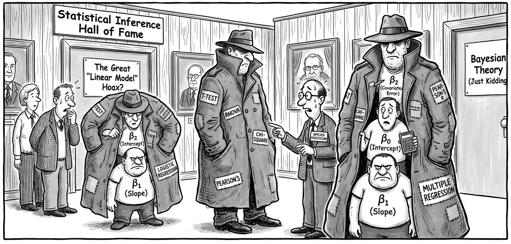
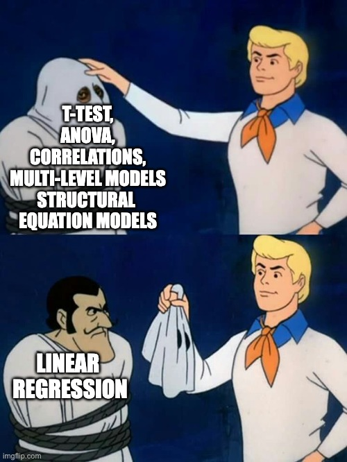
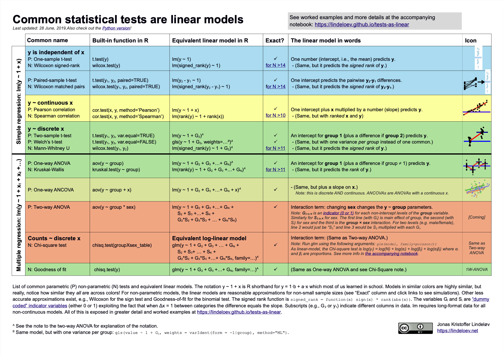

# Everything is regression

```{r}
#| include: false
# if it is available, run the setup script that tells quarto to round all df/tibble outputs to three decimal places
if(file.exists("../_setup.R")){source("../_setup.R")}
```

Ok not everything. But a large proportion of the most commonly used statistical methods are just a linear regression model hiding in a trench coat.

{.center width="90%"}

This chapter uses the data simulation principles and skills you learned in the chapters in Part I to demonstrate this. You don't need to understand the code that simulates the data in order to follow the chapter: each simulated dataset simply stands in for a dataset you might collect.

This chapter is heavily inspired by Jonas Lindeløv's blog post ['Common statistical tests are linear models (or: how to teach stats)'](https://lindeloev.github.io/tests-as-linear). We recommend you read his post in its entirety. We agree with Lindeløv that it might be better to frame much of our teaching of statistical inference around this insight, rather than introducing it very late in our training.

The chapter first explains what a linear regression model is, by building it up from the equation of a straight line. It then shows that many named tests, meta-analyses, and even factor analyses are the same model in disguise. It ends with a reference guide to the notation R uses to specify these models.

```{r}
# dependencies
library(faux)
library(tibble)
library(dplyr)
library(forcats)
library(ggplot2)
library(scales)
library(broom)
library(parameters)
library(modelbased)
library(see)
library(lme4)
library(metafor)
library(lavaan)
library(semPlot)
```

## Regression is just the slope of a line

### Linking different notation types

Equation of a line as we are taught in school:

$$
y = m*x + c
$$

Bridge from school notation to linear regression notation:

$$
\underbrace{y}_{\text{outcome}} = \underbrace{c}_{\beta_{\text{intercept}}} \cdot \underbrace{1}_{\text{intercept}} + \underbrace{m}_{\beta_{\text{slope}}} \cdot \underbrace{x}_{\text{predictor}} + \underbrace{\varepsilon}_{\text{error}}
$$

The linear model notation:

$$
y = \beta_{\text{intercept}} \cdot 1 + \beta_{\text{slope}} \cdot x + \varepsilon
$$

Compared with the equation of a line, this adds an error term, $\varepsilon$, to quantify uncertainty and noise: real data points don't fall perfectly on a line.

The same model is sometimes written with a subscript $i$ for each participant, to make clear that every participant has their own value of $x$, their own value of $y$, and their own error, while the $\beta$s are shared by everyone:

$$
y_i = \beta_{\text{intercept}} \cdot 1 + \beta_{\text{slope}} \cdot x_i + \varepsilon_i
$$

'Wilkinson notation' to specify and fit the regression in R:

```{r}
#| include: false
# simulate some cross sectional data
set.seed(43)

# y = sleep measured by the PSQI
# x = depression measured by the BDI-II
dat <- faux::rnorm_multi(
  n = 600,
  vars = 2,
  varnames = c("x", "y"),
  mu = c(15, 6.5),
  sd = c(10, 3.5),
  r = 0.57
) %>%
  as_tibble()
```

```{r}
fit <- lm(y ~ 1 + x,
          data = dat)
```

The outcome or dependent variable, $y$, goes to the left of `~`. The predictor or independent variable, $x$, goes to the right. The intercept is written as `1` because, as in the formula above, $\beta_{\text{intercept}}$ is multiplied by the constant 1 for every participant.

This asks R to estimate $\beta_{\text{intercept}}$ for 1 (the intercept), $\beta_{\text{slope}}$ for x, and the remaining error $\varepsilon$.

We can then see those estimates, where 'Coefficient' refers to the Beta coefficients:

```{r}
model_parameters(fit)
```

However, because the above code doesn't explicitly mention the Beta parameters, its connection to the formula can feel unclear. We think it can be helpful to see the same model specified in the {lavaan} package, which does let you explicitly name these parameters in the model.

```{r}
fit_lavaan <- lavaan::sem(model = 'y ~ beta_intercept * 1 + beta_slope * x',
                          data = dat)
```

We can then see the estimates again. Note that because {lavaan} uses Maximum Likelihood estimation rather than Ordinary Least Squares estimation it will provide slightly different results - the point is just to see the connection between the formula and the model.

```{r}
# nb model_parameters() doesn't return the intercept so extract it more manually
lavaan::parameterEstimates(fit_lavaan) |>
  filter(label %in% c("beta_intercept", "beta_slope")) %>%
  select(label, beta = est, ci_low = ci.lower, ci_high = ci.upper, p = pvalue)
```

### Understanding regression fit and residuals

How does `lm()` decide where to draw the line?

The plot below shows simulated data and the regression line fitted to it. The vertical lines are the residuals: the difference between each observed value of y and the value predicted by the regression line. The regression line is the line that makes the sum of the *squared* residuals as small as possible, which is why it is called "ordinary least squares" regression.

```{r}
set.seed(123)

# 1. Simulate data for y ~ x
n  <- 100
x  <- rnorm(n, mean = 0, sd = 1)
e  <- rnorm(n, mean = 0, sd = 1)       # noise
y  <- 2 + 0.5 * x + e                  # true model: y = 2 + 0.5x + error

dat_residuals <- data.frame(x = x, y = y)

# 2. Fit linear model
fit_residuals <- lm(y ~ 1 + x, data = dat_residuals)

# 3. Get fitted values and residuals using broom
dat_aug <- augment(fit_residuals) %>%
  # keep only the relevant columns and give them sensible names
  transmute(
    x         = x,
    y         = y,
    fitted    = .fitted,
    resid     = .resid,
    std_resid = .std.resid,
    hat       = .hat,
    cooksd    = .cooksd
  )

# 4. Plot: points + fitted line + vertical segments (residuals)
p <- ggplot(dat_aug, aes(x = x, y = y)) +
  # vertical segments from point to fitted value at same x
  geom_segment(aes(xend = x, yend = fitted),
               linewidth = 0.3, alpha = 0.6) +
  # points
  geom_point() +
  # fitted regression line
  geom_smooth(method = "lm", se = FALSE) +
  labs(
    x = "x",
    y = "y",
    title = "Observed points and vertical residuals from fitted regression line"
  ) +
  theme_linedraw()

p
```

Because we simulated this data, we know the true values of the parameters: an intercept of 2 and a slope of 0.5. Note that the estimates from `lm()` recover them closely, but not exactly, because of the random error in this particular sample:

```{r}
model_parameters(fit_residuals)
```

The plot below lets you explore this yourself, with a smaller set of 15 points from the same model.

-   Click on an empty part of the plot to add a point there.
-   Click on an existing point to remove it.

The regression line, residuals, and fit statistics update immediately. Some things to try:

-   Add a point far above or below the line, near the *middle* of the x-axis. Then add one the same distance from the line at the far *left or right* of the plot. Which one moves the line more? Points with extreme x values have more "leverage".
-   Remove all the points, then add them back one at a time. What happens with only one point? With two?
-   Add a cluster of points that follow a different pattern, and watch the slope change.
-   Show the intercept-only model. This is the model `lm(y ~ 1)`, whose prediction for every point is simply the mean of y. We return to the intercept-only model [below](#the-simplest-model-the-intercept-only-model).

```{r}
#| include: false
# simulate a small data set from the same model, to pass to the interactive plot below
set.seed(42)

dat_interactive <- data.frame(x = rnorm(n = 15, mean = 0, sd = 1)) %>%
  mutate(y = 2 + 0.5 * x + rnorm(n = 15, mean = 0, sd = 1))

ojs_define(dat_interactive_init = dat_interactive)
```

```{ojs}
//| echo: false
viewof show = Inputs.checkbox(["Residuals", "Intercept-only model (mean of y)"], {label: "Show", value: ["Residuals"]})
viewof reset_points = Inputs.button("Reset to the original points")
viewof clear_points = Inputs.button("Remove all points")
```

```{ojs}
//| echo: false
//| output: false
// points currently in the plot
initial_points = transpose(dat_interactive_init).map(d => ({x: d.x, y: d.y}))
mutable points = initial_points
```

```{ojs}
//| echo: false
//| output: false
// buttons: value counts the number of clicks, so only act after the first click
{ if (reset_points > 0) mutable points = initial_points }
```

```{ojs}
//| echo: false
//| output: false
{ if (clear_points > 0) mutable points = [] }
```

```{ojs}
//| echo: false
//| output: false
// ordinary least squares regression of y on x
show_residuals = show.includes("Residuals")
show_mean = show.includes("Intercept-only model (mean of y)")
fit = {
  const n = points.length
  if (n === 0) return {n, ok: false}
  const mean_x = d3.mean(points, d => d.x)
  const mean_y = d3.mean(points, d => d.y)
  const ss_x = d3.sum(points, d => (d.x - mean_x) ** 2)
  const ss_total = d3.sum(points, d => (d.y - mean_y) ** 2)
  if (n < 2 || ss_x === 0) return {n, ok: false, mean_y, ss_total}
  const slope = d3.sum(points, d => (d.x - mean_x) * (d.y - mean_y)) / ss_x
  const intercept = mean_y - slope * mean_x
  const residuals = points.map(d => ({...d, fitted: intercept + slope * d.x, resid: d.y - (intercept + slope * d.x)}))
  const ss_resid = d3.sum(residuals, d => d.resid ** 2)
  return {n, ok: true, slope, intercept, mean_y, residuals, ss_resid, ss_total}
}
```

```{ojs}
//| echo: false
regression_plot = {
  const x_domain = [-3, 3]
  const y_domain = [-1, 5]

  const plot = Plot.plot({
    width: Math.min(width, 640),
    height: 420,
    marginLeft: 45,
    x: {label: "x", domain: x_domain, grid: true},
    y: {label: "y", domain: y_domain, grid: true},
    clip: true,
    marks: [
      Plot.frame({stroke: "currentColor"}),
      // intercept-only model: the mean of y, and residuals from it (offset slightly so they don't overlap the regression residuals)
      show_mean && points.length > 0 ? Plot.ruleY([fit.mean_y], {stroke: "#e67e22", strokeWidth: 2, strokeDasharray: "6,4"}) : null,
      show_mean && points.length > 0 ? Plot.ruleX(points, {x: "x", y1: "y", y2: () => fit.mean_y, stroke: "#e67e22", strokeOpacity: 0.6, dx: 4}) : null,
      // residuals: vertical lines from each point to the regression line
      show_residuals && fit.ok ? Plot.ruleX(fit.residuals, {x: "x", y1: "y", y2: "fitted", stroke: d => d.resid > 0 ? "#2780e3" : "#e74c3c", strokeOpacity: 0.8}) : null,
      // regression line
      fit.ok ? Plot.line(x_domain.map(x => ({x, y: fit.intercept + fit.slope * x})), {x: "x", y: "y", stroke: "currentColor", strokeWidth: 2.5}) : null,
      // points
      Plot.dot(points, {x: "x", y: "y", r: 5, fill: "currentColor", stroke: "white", strokeWidth: 1})
    ]
  })

  // convert between data values and pixels using the plot's scales
  const x_scale = plot.scale("x")
  const y_scale = plot.scale("y")
  const to_data = (value, scale) => scale.domain[0] + (value - scale.range[0]) / (scale.range[1] - scale.range[0]) * (scale.domain[1] - scale.domain[0])
  const to_pixel = (value, scale) => scale.range[0] + (value - scale.domain[0]) / (scale.domain[1] - scale.domain[0]) * (scale.range[1] - scale.range[0])

  plot.style.cursor = "crosshair"
  plot.addEventListener("click", event => {
    const [px, py] = d3.pointer(event, plot)
    // ignore clicks outside the plotting area
    const [x_min, x_max] = d3.extent(x_scale.range)
    const [y_min, y_max] = d3.extent(y_scale.range)
    if (px < x_min || px > x_max || py < y_min || py > y_max) return
    // if the click is on (or very near) an existing point, remove it; otherwise add a new point
    const distances = points.map(d => Math.hypot(to_pixel(d.x, x_scale) - px, to_pixel(d.y, y_scale) - py))
    const nearest = d3.minIndex(distances)
    if (points.length > 0 && distances[nearest] < 10) {
      mutable points = points.filter((d, i) => i !== nearest)
    } else {
      mutable points = [...points, {x: to_data(px, x_scale), y: to_data(py, y_scale)}]
    }
  })

  return plot
}
```

```{ojs}
//| echo: false
fit.ok
  ? html`<p><strong>Regression line:</strong> y = ${fit.intercept.toFixed(2)} + ${fit.slope.toFixed(2)} × x<br>
<strong>Number of points:</strong> ${fit.n}<br>
<strong>Sum of squared residuals:</strong> ${fit.ss_resid.toFixed(2)} (intercept-only model: ${fit.ss_total.toFixed(2)})</p>`
  : html`<p><strong>Number of points:</strong> ${fit.n}. A regression line needs at least two points with different x values.</p>`
```

### Understanding regression as prediction

Beta estimates often feel highly abstract. We can understand them better in the context of the original linear regression formula, as a way to make predictions about new observations.

To do this, we simply use the regression formula and the estimates from the model. Insert the estimates for $\beta_{\text{intercept}}$ and $\beta_{\text{slope}}$ from the depression and sleep model above into the original regression equation.

Then, add a new value of $x$ to represent a hypothetical new participant. Let's imagine this participant has a depression score ($x$) of 25 on the BDI-II, representing moderate depression.

By multiplying the numbers, we find the participant's predicted sleep score on the PSQI ($y$).

$$
\begin{aligned}
y &= \beta_{\text{intercept}} \cdot 1 &+& \quad \beta_{\text{slope}} \cdot x \\
  &= 3.5                     \cdot 1 &+& \quad 0.2 \cdot 25 \\
  &= 8.5
\end{aligned}
$$

Predicted sleep quality is 8.5, where scores on the PSQI > 5 indicate poor sleep and clinical populations often score in the 8 to 14 range.

R can do this calculation for us with `predict()`, by supplying the fitted model and a data frame containing the new participant's value of $x$. Because `predict()` uses the unrounded estimates rather than the rounded ones we used above, its answer differs slightly:

```{r}
predict(fit, newdata = data.frame(x = 25))
```

`predict()` can make predictions for many new participants at once, e.g., `data.frame(x = c(5, 15, 25))`.

### Linking the formula to Null Hypothesis Significance Testing (NHST)/*p* values

The association between depression and sleep quality is tested against the null hypothesis ($H_0$) that the association between $x$ and $y$ - ie $\beta_{\text{slope}}$ - is zero. The alternative hypothesis ($H_1$) is therefore that the association is non-zero. A detectable non-zero slope allows for the inference that depression is associated with poor sleep.

$$
H_0\!: \beta_{\text{slope}} = 0
\\
H_1\!: \beta_{\text{slope}} \neq 0
$$

Inferences regarding whether the slope is non-zero *in the population rather than the sample* are based on quantifying the uncertainty around the estimate of $\beta_{\text{slope}}$, for example through Confidence Intervals and *p*-values. We won't get into how that is done here; the point here is to link *p*-values (which you are likely more familiar with) to the slope of the line equation underlying linear regression (which you may be less familiar with).

## The simplest model: the intercept-only model

We can make the linear model even simpler by removing the predictor entirely. An intercept-only linear regression model has no predictors, only the intercept. E.g., `y ~ 1`.

$$
y = \beta_{\text{intercept}} \cdot 1 + \varepsilon
$$

This model makes the same prediction for every participant. What is the best single prediction we can make for everyone? It is the value that makes the sum of squared residuals as small as possible, which is the mean.

This means that even 'the sample mean' and 'the sample Standard Deviation' are linear regression models:

- The sample mean is the estimate of the intercept of an intercept-only linear regression model.
- The sample Standard Deviation is the estimate of the residual standard error of an intercept-only linear regression model. In other words, the SD summarizes how far the data points typically fall from the mean, which is exactly what the residuals measure.

Note the equivalent estimates.

```{r}
set.seed(42)

dat_intercept_only <- data.frame(y = rnorm(n = 46, mean = 1.2, sd = 2.45))

fit_named <- dat_intercept_only |>
  summarize(mean = mean(y),
            sd = sd(y))

fit_named
```

```{r}
fit_lm <- lm(formula = y ~ 1,
             data = dat_intercept_only)

model_parameters(fit_lm)

coef(fit_lm)["(Intercept)"] # intercept, ie the mean when an intercept-only model
sigma(fit_lm) # residual standard error, ie the SD when an intercept-only model
```

### Why the residual standard error is the SD

To see why, it helps to look at the residuals of this model.

Recall from the [residuals plot above](#understanding-regression-fit-and-residuals) that a residual is the vertical distance between a data point and the model's prediction for it. In an intercept-only model, the prediction for every participant is the same: the intercept, i.e., the mean. So each participant's residual is simply their score minus the mean.

$$
\varepsilon_i = y_i - \beta_{\text{intercept}} = y_i - \bar{y}
$$

We can see this for the first few participants. Participants scoring above the mean have positive residuals, and those scoring below it have negative ones:

```{r}
dat_intercept_only <- dat_intercept_only |>
  mutate(participant = row_number(),
         intercept = coef(fit_lm)["(Intercept)"], # the model's prediction for every participant, ie the mean
         residuals = residuals(fit_lm))

dat_intercept_only |>
  mutate(y_minus_mean = y - mean(y)) |> # calculate the residuals by hand, for comparison
  select(participant, y, intercept, residuals, y_minus_mean) |>
  head()
```

Plotted in the same way as the residuals plot above, the regression line of an intercept-only model is a flat line at the mean, and the residuals are the vertical lines from each participant's score to it. This is the same as the "Intercept-only model" option in the interactive plot above.

```{r}
ggplot(dat_intercept_only, aes(x = participant, y = y)) +
  # vertical segments from each point to the mean
  geom_segment(aes(xend = participant, yend = intercept),
               linewidth = 0.3, alpha = 0.6) +
  geom_point() +
  # the intercept-only model's prediction: the mean
  geom_hline(yintercept = mean(dat_intercept_only$y), color = "#2780e3", linewidth = 1) +
  labs(x = "Participant",
       y = "y",
       title = "Residuals from an intercept-only model are distances from the mean") +
  theme_linedraw()
```

Now consider how the SD is calculated. It is the square root of the average squared distance of each score from the mean (where the 'average' divides by $n - 1$ rather than $n$). But each of those distances from the mean is a residual, so the SD formula is also the formula for the residual standard error of an intercept-only model:

$$
SD = \sqrt{\frac{\sum_{i=1}^{n} (y_i - \bar{y})^2}{n - 1}} = \sqrt{\frac{\sum_{i=1}^{n} \varepsilon_i^2}{n - 1}} = \text{residual standard error}
$$

In other words, the SD and the residual standard error are not just two numbers that happen to match: they are the same calculation. Note the identical results:

```{r}
# the SD of the data
sd(dat_intercept_only$y)

# the residual standard error, calculated by hand from the residuals
sqrt(sum(dat_intercept_only$residuals^2) / (nrow(dat_intercept_only) - 1))

# the residual standard error, as reported by lm()
sigma(fit_lm)
```

More generally, the residual standard error of any linear model divides by $n - k$, where $k$ is the number of $\beta$ parameters the model estimates. An intercept-only model estimates only one, so it divides by $n - 1$, just as the SD does. This is also why the SD divides by $n - 1$: one degree of freedom is used up by estimating the mean.

Finally, because every residual is just a score minus the same constant (the mean), the distribution of the residuals is the distribution of the data, shifted along so that it is centered on zero rather than the mean. Its shape and spread are unchanged. The plot below shows the two side by side, with the mean marked for each.

```{r}
#| fig-height: 3.5
#| fig-width: 8
dat_distributions <- bind_rows(
  tibble(variable = "Data (y)", value = dat_intercept_only$y),
  tibble(variable = "Residuals", value = dat_intercept_only$residuals)
)

dat_means <- dat_distributions |>
  group_by(variable) |>
  summarize(mean = mean(value),
            sd = sd(value))

dat_means

ggplot(dat_distributions, aes(value)) +
  geom_density() +
  geom_vline(data = dat_means, aes(xintercept = mean), linetype = "dashed") +
  facet_wrap(~ variable) +
  labs(x = "Value", y = "Density") +
  theme_linedraw()
```

Note that the two distributions have the same shape and the same SD, but the data are centered on the mean (`r round(mean(dat_intercept_only$y), 2)`), whereas the residuals are centered on 0. So the mean tells us *where* the data are, the SD tells us how spread out they are around that point, and an intercept-only regression model estimates both.

::: {.callout-note title="The normality assumption is about the residuals"}
Linear regression assumes that the *residuals* are normally distributed, i.e., the error term $\varepsilon$ in $y = \beta_{\text{intercept}} \cdot 1 + \beta_{\text{slope}} \cdot x + \varepsilon$. It does not assume that the outcome variable $y$, or the predictors, are normally distributed.

In an intercept-only model the two are the same thing, because the residuals are just the data shifted to center on zero. But once a model has predictors, they can differ a lot. For example, in a *t*-test (which we will see [below](#t-tests-are-linear-regression-models) is a regression with one predictor), the residuals are each participant's distance from their *own group's* mean. If the two groups' means are far apart, the combined scores can have two peaks and look very non-normal, even when the residuals are perfectly normal.

So when checking the normality assumption of a regression model, or of the named tests that are regression models in disguise, check the residuals rather than the raw data. We return to assumptions, and what happens when they are violated, in the chapters on [violating assumptions](14_violating_assumptions.qmd) and [testing assumptions](15_testing_assumptions_and_conditional_tests.qmd).
:::

## Many common tests are just regression

Now that we have seen what a linear regression model is, we can see it hiding inside many other named tests.

{.center width="60%"}

Lindeløv summarizes many of these equivalences in a useful infographic:

{.center width="100%"}

### Correlations are linear regression models

Correlations are just a linear regression model where the IV and DV have both been standardized by their sample Standard Deviations (i.e., score/SD).

Whereas the Beta coefficient from the linear regression model is interpreted as "a one-point increase in the IV is associated with a [Beta]-points change on the DV", the Pearson's *r* correlation merely modifies the units from the native scale to the number of Standard Deviations. I.e., "a one-SD increase in the IV is associated with a [Beta]-SD changes (aka *r*) on the DV".

```{r}
# simulate some cross sectional data
set.seed(43)

data_crosssectional <- faux::rnorm_multi(
  n = 600,
  vars = 2,
  varnames = c("x", "y"),
  mu = c(0, 0.5), # population mean by variable
  sd = 1, # population sd by variable or, if a single value given, SD for all variables
  r = 0.35 # correlation matrix or, if a single value given, correlation between all variables
) %>%
  as_tibble() # faux returns a data.frame; we convert to tibble for consistency

cor(data_crosssectional)
```

Note equivalent estimates (*r* = .36):

```{r}
fit_named <- cor.test(formula = ~ y + x,
                      data = data_crosssectional,
                      method = "pearson")

model_parameters(fit_named)
```

```{r}
fit_lm <- lm(formula = scale(y) ~ 1 + scale(x),
             data = data_crosssectional)

model_parameters(fit_lm)
```

### *t*-tests are linear regression models

*t*-tests are just linear regression models where the IV - the group variable - has been dummy-coded, e.g., from control/intervention to 0/1.

Whereas the Beta coefficient from the linear regression model is interpreted as "a one-point increase in the IV is associated with a [Beta]-points change on the DV", the *t*-test merely modifies this by treating "0" as one condition and "1" as the other. I.e., "a one-point increase in the IV, aka the difference between conditions, is associated with a [Beta]-points change (aka $M_{diff}$) on the DV".

```{r}
#| include: false
set.seed(42)
# simulate some experiment data
dat_experiment <-
  bind_rows(
    tibble(condition = rep("intervention", 40),
           score = rnorm(n = 40, mean = 0.45, sd = 1)),
    tibble(condition = rep("control", 40),
           score = rnorm(n = 40, mean = 0, sd = 1))
  ) %>%
  mutate(condition = fct_relevel(condition, "intervention", "control"),
         condition_numeric = case_when(condition == "intervention" ~ 1,
                                       condition == "control" ~ 0))
```

Note equivalent estimates of the difference in means ($M_{diff}$ = 0.33) and *p*-values (*p* = .175).

```{r}
fit_named <- t.test(formula = score ~ condition,
                    data = dat_experiment,
                    var.equal = TRUE)

model_parameters(fit_named)
```

```{r}
fit_lm <- lm(score ~ 1 + condition_numeric,
             data = dat_experiment)

model_parameters(fit_lm)
```

### One-way ANOVAs are linear regression models

A one-way ANOVA tests whether the means of three or more groups differ. Just as a *t*-test is a regression with one dummy-coded variable, a one-way ANOVA is a regression with several.

With three conditions, we need two dummy variables. For example, with a control condition and two interventions, one dummy variable is 1 for participants in intervention A and 0 for everyone else, and the other is 1 for participants in intervention B and 0 for everyone else. Participants in the control condition are 0 on both, so the control condition becomes the 'reference group' that the other conditions are compared to:

$$
\text{score} = \beta_{\text{intercept}} \cdot 1 + \beta_{\text{A}} \cdot \text{intervention}_{\text{A}} + \beta_{\text{B}} \cdot \text{intervention}_{\text{B}} + \varepsilon
$$

This means that:

- $\beta_{\text{intercept}}$ is the mean of the control condition, because control participants are 0 on both dummy variables.
- $\beta_{\text{A}}$ is the difference between the means of intervention A and control.
- $\beta_{\text{B}}$ is the difference between the means of intervention B and control.

```{r}
#| include: false
set.seed(42)
# simulate some experiment data with three conditions
dat_three_groups <-
  bind_rows(
    tibble(condition = rep("control", 40),
           score = rnorm(n = 40, mean = 0, sd = 1)),
    tibble(condition = rep("intervention_a", 40),
           score = rnorm(n = 40, mean = 0.3, sd = 1)),
    tibble(condition = rep("intervention_b", 40),
           score = rnorm(n = 40, mean = 0.6, sd = 1))
  ) %>%
  mutate(condition = fct_relevel(condition, "control", "intervention_a", "intervention_b"))
```

```{r}
fit_named <- aov(formula = score ~ condition,
                 data = dat_three_groups)

model_parameters(fit_named)
```

Next, we create the two dummy variables:

```{r}
dat_three_groups <- dat_three_groups |>
  mutate(intervention_a = if_else(condition == "intervention_a", 1, 0),
         intervention_b = if_else(condition == "intervention_b", 1, 0))

# show the coding for each condition
dat_three_groups |>
  distinct(condition, intervention_a, intervention_b)
```

And fit the linear regression model. Compare its estimates with the means of each condition: the intercept is the control condition's mean, and the other two Betas are the differences from it.

```{r}
fit_lm <- lm(score ~ 1 + intervention_a + intervention_b,
             data = dat_three_groups)

model_parameters(fit_lm)

dat_three_groups |>
  group_by(condition) |>
  summarize(mean = mean(score))
```

The ANOVA's *F*-test asks whether the conditions differ *at all*. In regression terms, it asks whether the model with the dummy variables predicts the scores better than a model that predicts the same value for everyone, i.e., the [intercept-only model](#the-simplest-model-the-intercept-only-model), whose prediction for everyone is the overall mean. We can test this by comparing the two models with `anova()`.

Note equivalent *F*-values (*F* = `r round(summary(fit_named)[[1]][["F value"]][1], 2)`) and *p*-values (*p* = `r round(summary(fit_named)[[1]][["Pr(>F)"]][1], 3)`) to the ANOVA above:

```{r}
fit_intercept_only <- lm(score ~ 1,
                         data = dat_three_groups)

anova(fit_intercept_only, fit_lm) |>
  model_parameters()
```

In practice, you rarely need to create dummy variables yourself. When a predictor is a factor, `lm()` creates the dummy variables automatically, using the factor's first level as the reference group. Note that this produces the same estimates as above, and that calling `anova()` on it produces the same *F*-test as the ANOVA:

```{r}
fit_lm_factor <- lm(score ~ 1 + condition,
                    data = dat_three_groups)

model_parameters(fit_lm_factor)

anova(fit_lm_factor) |>
  model_parameters()
```

### Many non-parametric tests are just linear models with transformations

When the assumptions of parametric tests like *t*-tests and correlations fail, we are often recommended to use 'non-parametric' tests instead. Many of these are just linear models with rank transformations.

#### Spearman's $\rho$ correlations

Note equivalent estimates ($\rho$ = .36):

```{r}
fit_named <- cor.test(formula = ~ y + x,
                      data = data_crosssectional,
                      method = "spearman")

model_parameters(fit_named)
```

```{r}
fit_lm <- lm(formula = rank(y) ~ 1 + rank(x),
             data = data_crosssectional)

model_parameters(fit_lm)
```

#### Mann-Whitney U-test (aka Wilcoxon rank-sum test)

Note (approximately) equivalent *p*-values (*p* = .183).

```{r}
fit_named <- wilcox.test(formula = score ~ condition,
                         data = dat_experiment,
                         correct = FALSE) # without continuity correction

model_parameters(fit_named)
```

```{r}
fit_lm <- lm(rank(score) ~ 1 + condition_numeric,
             data = dat_experiment)

model_parameters(fit_lm)
```

## Meta-analyses are linear regression models, and meta-analyses are multi-level models

### Equal-effects meta-analysis is a weighted intercept-only model

Specifically, linear models that weight by the sample size (in much older studies) or the effect size's variance (in modern meta analyses) so that larger studies with more precisely estimated effect sizes influence the meta-analysis estimate more. You can see in the forest plot below that the more precise estimates - those with narrower Confidence Intervals - have larger weights, represented by the larger squares. Psychology doesn't use regression weightings in non-meta-analysis contexts very often, but [perhaps we should (Alsalti, Hussey, Elson and Arslan, 2026)](https://doi.org/10.1525/collabra.155850).

The other main conceptual difference between meta-analyses and original analyses is that meta-analyses typically use the results of original studies as their data (i.e., effect size estimates), rather than the underlying original data itself. However, this is still something we can use the linear regression functions for, simply by supplying it with effect size estimates rather than participant-level data.

Notice also that the meta-analysis below is an intercept-only model, `pearsons_r ~ 1`. Just as the intercept of an intercept-only model is the mean, the meta-analytic effect size is a *weighted* mean of the studies' effect sizes.

```{r}
#| fig-height: 5
#| fig-width: 7
data_meta <-
  escalc(measure = "COR",
         ri = ri,
         ni = ni,
         data = dat.molloy2014) %>% # use metafor's built-in dataset
  select(authors,
         year,
         pearsons_r = yi,
         pearsons_r_variance = vi) |>
  mutate(study = row_number()) # an ID for each study, used in the multi-level model below

# fit an equal-effects meta-analysis model
# these are less commonly recommended these days, but it illustrates the point
fit_meta <- rma(yi = pearsons_r,
                vi = pearsons_r_variance,
                data = data_meta,
                method = "EE")

forest(fit_meta, slab = paste(authors, year))

# model_parameters(fit_meta) # optionally, print table to see that model_parameters() works with many different models
```

Note equivalent estimates of the meta-analysis effect size (*r* = .13):

```{r}
fit_lm <- lm(pearsons_r ~ 1,
             weights = 1/pearsons_r_variance,
             data = data_meta)

model_parameters(fit_lm)
```

However, unlike the named tests above, only the point estimate is identical. The Standard Errors, Confidence Intervals, and *p*-values differ: the meta-analysis reports a SE of `r round(fit_meta$se, 3)` whereas `lm()` reports `r round(summary(fit_lm)$coefficients[1, "Std. Error"], 3)`. This is because a meta-analysis treats each study's sampling variance as *known*, whereas `lm()` treats the weights as only relative and estimates an additional residual variance from the data, which it then scales the SEs by. See [this helpful blog post](https://www.metafor-project.org/doku.php/tips:rma_vs_lm_lme_lmer) by Wolfgang Viechtbauer, the developer of the {metafor} package for meta-analysis, for an explanation of this underlying equivalence and the small implementation differences between R packages and methods.

### Random-effects meta-analysis is a multi-level model

The equal-effects model above assumes that every study estimates the same single true effect, and that studies differ only because of sampling error. Random-effects meta-analysis, which is more commonly recommended, instead assumes that the true effect itself varies between studies, for example because of differences in samples, measures, or procedures. It estimates the average of those true effects and how much they vary, called $\tau^2$ (tau-squared).

This is a multi-level model: effect sizes are nested within studies, and each study gets its own 'random intercept'. We can see this by fitting the same model in two ways. First, as a standard random-effects meta-analysis:

```{r}
fit_meta_re <- rma(yi = pearsons_r,
                   vi = pearsons_r_variance,
                   data = data_meta,
                   method = "REML")

model_parameters(fit_meta_re, include_studies = FALSE) # print only the meta-analytic estimate, not each study's
```

Second, using {metafor}'s more general multi-level function, which lets us explicitly specify a random intercept for each study using the same `1 | group` notation used by multi-level models in the {lme4} package (see [Formula notation reference](#formula-notation-reference) below).

```{r}
fit_meta_ml <- rma.mv(yi = pearsons_r,
                      V = pearsons_r_variance,
                      random = ~ 1 | study,
                      data = data_meta)

model_parameters(fit_meta_ml, include_studies = FALSE)
```

Note the identical estimates of the meta-analytic effect size and its uncertainty. The estimated between-study variance is also the same: $\tau^2$ = `r round(fit_meta_re$tau2, 4)` from `rma()`, and the random intercept variance $\sigma^2$ = `r round(fit_meta_ml$sigma2, 4)` from `rma.mv()`.

A random-effects meta-analysis can be fitted with general-purpose multi-level model functions like `lme4::lmer()` too, but, as with `lm()` above, only approximately: `lmer()` cannot be told that each study's sampling variance is known. Viechtbauer's [blog post](https://www.metafor-project.org/doku.php/tips:rma_vs_lm_lme_lmer) explains this in detail.

## Multi-level models

Meta-analysis gives us an entry point into multi-level models (aka mixed-effects models), which include both 'fixed effects' and 'random effects'.

### Fixed vs random effects

When categorical, fixed effects variables are typically "exhaustive", in that the levels present in the data are all the possible options (they 'exhaust' the possible options). In contrast, random effects variables are "non-exhaustive", in that other levels might exist in the world. For example, I would be more likely to use 'journal' as a random effect variable because I only have 5 journals per subfield in my data, but many other journals exist in these subfields in the real world. Similarly, the studies in a meta-analysis are only some of the studies that could have been run.

Additionally, random effects can be used to acknowledge dependencies in data. For example, if participants' positive affect was measured 5 times a day for 1 week, you would have 35 data points per participant. Simple regressions are fixed effects only and assume independence of the data. Mixed effects models allow you to include random effects to acknowledge that the same participant produced these 35 data points.

Separately, fixed effects variables assume that there is a single true value for each parameter in the population, whereas random effects assume that there is a distribution of true population parameters. Random effects estimate the hyperparameters of those distributions, for example their SD. This is what $\tau$ is in the random-effects meta-analysis above: the SD of the distribution of true effects across studies.

Packages like {lme4} and {brms} are excellent for fitting multilevel models. Equally importantly, packages such as those in the {easystats} universe of packages, e.g., {modelbased}, {parameters}, and {see} are very useful for extracting, interpreting and plotting results from multilevel models, as is the {marginaleffects} package.

### An example: self-report measures in journal articles

Imagine we coded 450 journal articles published over 10 years, and counted how many self-report measures each one used. We want to know whether the number of self-report measures has changed over time. The articles come from 6 subfields of psychology, with 5 journals in each subfield, and 15 articles from each journal.

Articles from the same journal are likely to be more similar to one another than articles from different journals, for example because each journal has its own editorial norms. The same applies to journals within the same subfield. This means that the articles are not independent of one another.

We will simulate data where this is true, so that we know the right answers:

- The number of self-report measures increases by 0.5 per year (the fixed effect of year).
- Subfields differ in their average number of measures, with an SD of 0.8 between subfields (a random intercept for subfield).
- Journals within a subfield also differ, with an SD of 0.5 between journals (a random intercept for journal).
- Individual articles vary around their journal's average, with an SD of 1 (the residual error).

You don't need to understand how the {faux} functions work in order to follow the rest of the example, but each line corresponds to one of the bullet points above.

```{r}
set.seed(42)

dat_articles <-
  # create the nested structure: articles within journals within subfields
  add_random(subfield = 6) |>
  add_random(journal = 5, .nested_in = "subfield") |>
  add_random(article = 15, .nested_in = "journal") |>
  # give each subfield and each journal its own random intercept
  add_ranef(.by = "subfield", subfield_intercept = 0.8) |>
  add_ranef(.by = "journal", journal_intercept = 0.5) |>
  # each article's publication year (0 to 9), its residual error, and the outcome
  mutate(year = sample(0:9, size = n(), replace = TRUE),
         error = rnorm(n = n(), mean = 0, sd = 1),
         count_selfreport_measures = 3 + 0.5*year + subfield_intercept + journal_intercept + error)

head(dat_articles)
```

#### Fixed effects only model

First, we fit a standard linear regression that ignores the fact that the articles are grouped into journals and subfields.

```{r}
fit_fe <- lm(formula = count_selfreport_measures ~ 1 + year,
             data = dat_articles)

model_parameters(fit_fe)

sigma(fit_fe) # residual standard error
```

Predicted values by year:

```{r}
predictions_fe <- estimate_expectation(fit_fe, by = "year")

predictions_fe

ggplot(predictions_fe, aes(x = year, y = Predicted)) +
  geom_ribbon(aes(ymin = CI_low, ymax = CI_high), alpha = 0.2) +
  geom_line() +
  scale_x_continuous(breaks = scales::breaks_pretty(n = 10)) +
  labs(x = "Year",
       y = "Predicted Count of Self-Report Measures") +
  theme_linedraw()
```

#### Multi-level model

Next, we add a random intercept for each subfield, and for each journal nested within subfield. This is written `(1 | subfield/journal)`: an intercept (`1`) that varies by (`|`) subfield, and by journal within (`/`) subfield.

```{r}
fit_ml <- lmer(formula = count_selfreport_measures ~ 1 + year + (1 | subfield/journal),
               data = dat_articles)

model_parameters(fit_ml, effects = "all")
```

Compare the two models:

- **The fixed effect of year** is similar in both models, and close to the true value of 0.5.
- **The random effects** recover the SDs of the subfield and journal intercepts that we simulated (0.8 and 0.5) reasonably well. With only 6 subfields, the subfield SD is estimated imprecisely, as you can see from its wide Confidence Interval.
- **The residual SD** in the multi-level model is close to the true value of 1, whereas in the fixed effects only model it is much larger. The fixed effects only model has no way of separating out the differences between journals and subfields, so it lumps them all into the residual error.
- **The SE of the intercept** is much larger in the multi-level model. The fixed effects only model treats the 450 articles as 450 independent pieces of information about the average number of measures. But because articles within the same journal and subfield are similar to each other, there is much less independent information than that, so the fixed effects only model is overconfident.

Predicted values by year, for each journal. Each line is a journal, and each panel is a subfield. All the lines have the same slope (the fixed effect of year), but each journal's line starts at a different height (its random intercept).

```{r}
#| fig-height: 6
#| fig-width: 9
predictions_ml <- estimate_expectation(fit_ml, by = c("year", "subfield", "journal")) |>
  # the prediction grid includes every combination of subfield and journal,
  # so keep only the combinations that exist in the data
  semi_join(distinct(dat_articles, subfield, journal),
            by = c("subfield", "journal"))

ggplot(predictions_ml, aes(x = year, y = Predicted, group = journal)) +
  geom_line() +
  labs(
    title = "Predicted Self-Report Measures by Subfield and Journal",
    x = "Year",
    y = "Predicted Count of Self-Report Measures"
  ) +
  scale_x_continuous(breaks = scales::breaks_pretty(n = 10)) +
  theme_linedraw() +
  facet_wrap(~ subfield)
```

## Confirmatory Factor Analysis is approximately a series of linear regression models

Confirmatory Factor Analysis (CFA) is often used to assess the measurement model of a scale: how strongly each item loads onto the latent factor that the scale is meant to measure. These factor loadings ($\lambda$) are closely related to the unstandardized Beta coefficients from a series of `lm()` calls, each predicting one item from the scale's sum score.

The connection also runs the other way: whenever we calculate a sum score for a scale, we are implicitly assuming a specific factor model, one in which every item has an equal loading on the factor. CFA lets us estimate the loadings rather than assume they are equal.

Unlike the equivalences above, however, this one is **approximate rather than exact**. The reason is that each item is itself part of the sum score, so the sum score carries that item's own measurement error. Regressing item $i$ on the sum score $S = \sum_j x_j$ gives:

$$
\beta_i = \frac{\operatorname{Cov}(x_i, S)}{\operatorname{Var}(S)} = \frac{\lambda_i \left(\sum_j \lambda_j\right) \psi \;+\; \theta_i}{\operatorname{Var}(S)}
$$

where $\psi$ is the factor variance and $\theta_i$ is item $i$'s residual (error) variance. That $\theta_i$ in the numerator is the item's own error leaking in from the sum score. Because it is *added* rather than multiplied, $\beta_i$ is not exactly proportional to $\lambda_i$, so no amount of rescaling can remove it. This is a structural difference, not sampling error: it does not shrink as the sample size grows. In practice it is small, and both methods recover the population loadings well.

```{r}
# the true item factor loadings (lambda) are 1, .8, 1.2, 0.9, and 1.1
population_model <- '
  # factor loadings
  F =~ 1.0*x1 + 0.8*x2 + 1.2*x3 + 0.9*x4 + 1.1*x5
  # factor variance
  F ~~ 1.5*F
  # item residual (error) variances
  x1 ~~ 0.5*x1
  x2 ~~ 0.4*x2
  x3 ~~ 0.6*x3
  x4 ~~ 0.5*x4
  x5 ~~ 0.5*x5
'

population_loadings <- c(1.0, 0.8, 1.2, 0.9, 1.1)
items <- c("x1", "x2", "x3", "x4", "x5")

set.seed(42)
data_scale <- simulateData(population_model, sample.nobs = 1000)
```

Note the similar estimates of the factor loadings.

```{r}
fit_named <- cfa('F =~ x1 + x2 + x3 + x4 + x5', data = data_scale)

cfa_loadings <- parameterEstimates(fit_named) |>
  # the "=~" rows are the factor loadings
  filter(op == "=~") |>
  pull(est)

cfa_loadings
```

```{r}
# the sum score across the scale's items
data_scale$sum_score <- rowSums(data_scale[, items])

# fit one model per item, predicting that item from the sum score, and extract its Beta.
# the same few lines are simply repeated for each item, so that each model is explicit
lm_betas <- c(
  lm(x1 ~ sum_score, data = data_scale) |>
    parameters() |>
    filter(Parameter == "sum_score") |>
    pull(Coefficient),
  lm(x2 ~ sum_score, data = data_scale) |>
    parameters() |>
    filter(Parameter == "sum_score") |>
    pull(Coefficient),
  lm(x3 ~ sum_score, data = data_scale) |>
    parameters() |>
    filter(Parameter == "sum_score") |>
    pull(Coefficient),
  lm(x4 ~ sum_score, data = data_scale) |>
    parameters() |>
    filter(Parameter == "sum_score") |>
    pull(Coefficient),
  lm(x5 ~ sum_score, data = data_scale) |>
    parameters() |>
    filter(Parameter == "sum_score") |>
    pull(Coefficient)
)

# CFA fixes the first loading to 1 to set the scale of the latent factor,
# so rescale the Betas by the first one to put them on the same footing
lm_loadings <- lm_betas / lm_betas[1]

lm_loadings
```

Both sets of estimates recover the population loadings closely:

```{r}
tibble(item               = items,
       population_loading = population_loadings,
       cfa_loading        = cfa_loadings,
       lm_loading         = lm_loadings)
```

But, as explained above, the two are not *exactly* equal, unlike the other equivalences in this chapter:

```{r}
max(abs(cfa_loadings - lm_loadings))
```

## Formula notation reference

This section collects the notation used to specify the models in this chapter, for reference.

### Wilkinson notation for regression and multi-level models

-   `~` regresses the variable on the left onto the variables on the right. The dependent variable (the thing caused or predicted) is on the left, the independent variables are on the right. E.g., `y ~ x` is "x causes/predicts/is associated with y".
-   `1` is the intercept. E.g., `y ~ 1 + x`.
-   `+` adds another predictor. E.g., `y ~ 1 + x1 + x2`.
-   `0` (or `- 1`) removes the intercept, forcing the regression line through zero. E.g., `y ~ 0 + x` or `y ~ x - 1`. This is rarely what you want for continuous predictors. With a factor predictor, it estimates each group's mean rather than the differences from the reference group. E.g., `y ~ 0 + condition`.
-   `:` adds an interaction between predictors, i.e., the product of the two. E.g., `y ~ 1 + x1 + x2 + x1:x2`. This allows the slope of `x1` to differ depending on the value of `x2`.
-   `*` is shorthand for both predictors plus their interaction. E.g., `y ~ 1 + x1 * x2` is the same as `y ~ 1 + x1 + x2 + x1:x2`.
-   `(1 | group)` is a random intercept: an intercept that varies by (`|`) group. E.g., `y ~ 1 + x + (1 | participant)`.
-   `(1 + x | group)` adds a random slope: the slope of `x` also varies by group, as well as the intercept. E.g., `y ~ 1 + time + (1 + time | participant)` allows each participant to have their own starting point and their own rate of change over time.
-   `(1 | a/b)` specifies random intercepts for `a`, and for `b` nested within (`/`) `a`. E.g., `y ~ 1 + year + (1 | subfield/journal)`. This is shorthand for `(1 | a) + (1 | a:b)`.
-   `(1 | a) + (1 | b)` specifies random intercepts for two crossed (i.e., not nested) grouping variables. E.g., in an experiment where every participant responds to the same set of stimuli, `y ~ 1 + condition + (1 | participant) + (1 | stimulus)`.

Note that intercepts are often implicit, and are usually calculated even if not specified. i.e., `y ~ x` == `y ~ 1 + x`. We include the `1` throughout this chapter to keep the link to the formula, $y = \beta_{\text{intercept}} \cdot 1 + \beta_{\text{slope}} \cdot x + \varepsilon$, visible (see [Linking different notation types](#linking-different-notation-types) above). The same applies to random effects: `(x | group)` is the same as `(1 + x | group)`.

### Latent variable modelling/CFA/SEM

Packages like {lavaan} are excellent for fitting Confirmatory Factor Analyses, Path Analyses, Structural Equation Models, and also simple regressions.

-   `~` to specify regressions, as in other Wilkinson notation.
-   `=~` to specify measurement models, i.e., unobserved latent variables defined by observed variables.
-   `~~` to specify correlated variances, e.g., for items in a measurement model that are known to be correlated or to acknowledge non-independence in data (e.g., between timepoints)

```{r}
model <- '
         # measurement model
         latent_x =~ x1 + x2 + x3   # Latent x is measured by observed variables x1, x2, and x3
         latent_m =~ m1 + m2 + m3 + m4 + m5 # Latent m is measured by observed variables m1, m2, m3, m4 and m5
         latent_y =~ y1 + y2 + y3 + y4  # Latent y is measured by observed variables y1, y2, y3 and y4

         # correlated variances (ie without specifying causality)
         x1 ~~ x2  # Residuals of x1 and x2 are allowed to correlate

         # structural model: specify regressions
         latent_m ~ latent_x
         latent_y ~ latent_x + latent_m
         '
```

```{r}
dat_sem <- lavaan::simulateData(model = model, sample.nobs = 100)

fit_sem <- sem(model = model, data = dat_sem)

semPaths(fit_sem,
         whatLabels = "diagram",
         edge.label.cex = 1.2,
         sizeMan = 5)
```

More advanced lavaan: `*` is used to give a parameter a label (as in `beta_slope * x` [above](#linking-different-notation-types)), and `:=` is used to define user parameters from labelled parameters.

```{r}
# specify mediation model which extracts custom parameters of interest
model <-  '
          M ~ a*X
          Y ~ b*M + c*X
          indirect := a*b
          direct := c
          total := c + (a*b)
          proportion_mediated := indirect / total
          '
```

::: {.callout-tip title = "Practice testing the equivalence of named tests and linear regression"}
Note that while there are exercises related to this chapter, we suggest that you do **not** complete them until you have read all of Part 1 of the book (learning how to simulate).

Download and complete the [exercises for this chapter](../exercises/11_everything_is_regression_exercises.qmd).
:::
